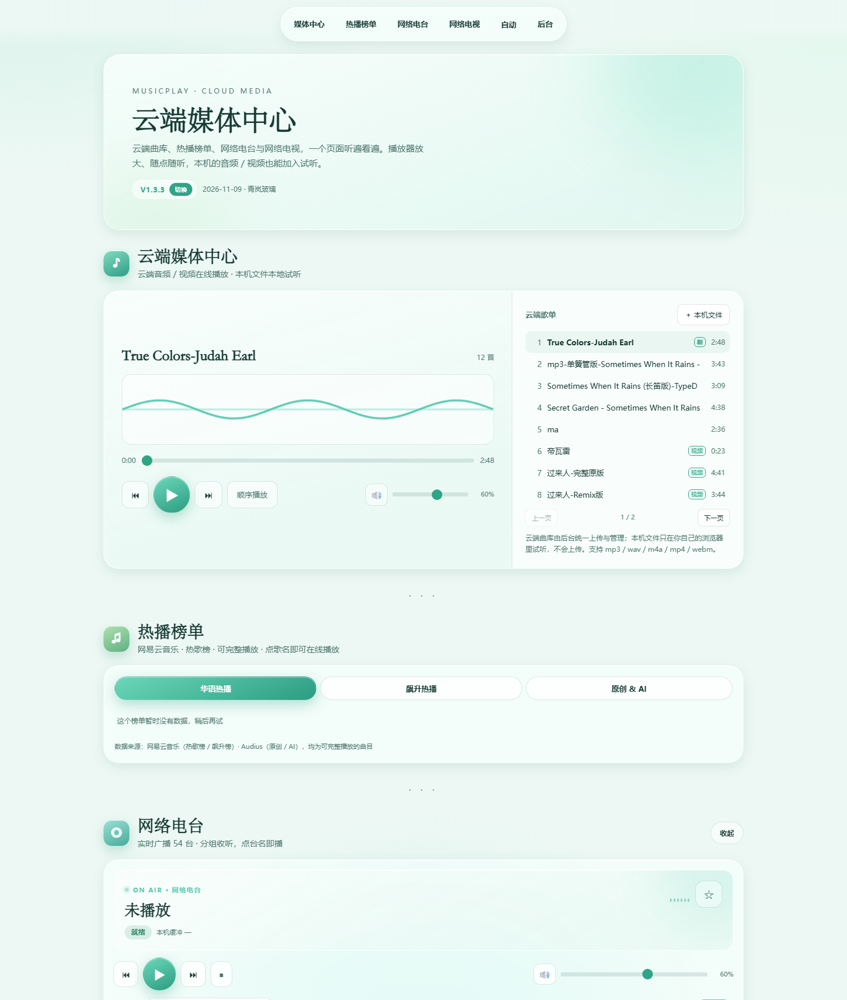
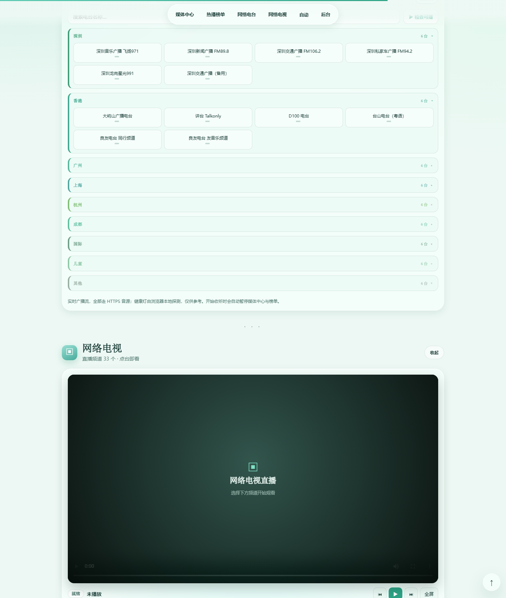

# 云媒体中心 MusicPlay

[](LICENSE)
[](https://cloudmusic.chinacn.eu.org)
[](https://github.com/szboboxing/musicplay/releases)
[](https://github.com/szboboxing/musicplay/commits/main)
[](https://cloudmusic.chinacn.eu.org)
[](https://szjack.pages.dev/)

单页媒体站，四个模块：

1. **云端媒体中心** —— 音频 / 视频播放，云端 R2 存储 + 本机文件试听，带上传进度
2. **热播榜单** —— 网易云音乐（华语 / 飙升）+ Audius（原创 / AI）
3. **网络电台** —— 54 台，深圳 / 香港 / 广州 / 上海 / 杭州 / 成都 / 国际 / 儿童 / 其他，分组折叠
4. **网络电视** —— 33 台，央视 9 / 深圳 6 / 香港 6 / 卫视 5 / 城市 5 / 国际 2

- 线上：<https://cloudmusic.chinacn.eu.org>
- 技术栈：Cloudflare Pages + Pages Functions + 共用媒体 Worker（R2）
- 部署：`.\deploy.ps1`（会把 theme.css + app.css 内联进首页，再发布）

> 欢迎访问个人站点 <https://szjack.pages.dev>，有彩蛋哦~


## 截图





## 目录

```
index.html            首页（媒体中心 / 榜单 / 电台 / 电视）
admin.html            后台（上传、下载、删除、批量管理、上传进度）
deploy.ps1            一键发布
assets/app.js         全部交互：播放器、电台、电视、hls.js 接入
assets/theme.css      主题与版本皮肤（V1.3.1 暖纸经典 / V1.3.3 青岚玻璃）
assets/app.css        各模块布局
functions/media/      云端媒体代理（→ Worker → R2）
functions/dl/         后台专用下载（Content-Disposition: attachment）
functions/tv/         HLS 代理：解决 http 混合内容 / 防盗链 / 跨域
functions/api/        榜单、媒体索引、登录
```

## 配置（全部走云端 Secret，仓库无密钥）

| Secret | 说明 |
| --- | --- |
| `ADMIN_PASSWORD` | 后台登录密码 |
| `SESSION_SECRET` | 登录态签名密钥 |
| `MEDIA_URL` | 媒体 Worker 基地址 |
| `MEDIA_TOKEN` | 与 Worker 一致的令牌 |
| `MEDIA_PUBLIC_URL` | R2 自定义域（可选） |

```powershell
npm i -g wrangler
wrangler login
cd musicplay
.\deploy.ps1
```

## 说明

- 电视里的 CCTV-3 / 5 / 5+ / 13 与深圳 6 台使用官方网页播放器内嵌（无公开 HLS 源）。
- HLS 代理只支持 Cloudflare 允许的端口（80 / 443 / 8080 / 8443），部分国内源在 CF 边缘会 403。
- 修改静态资源后请同步更新 `index.html` 里的 `?v=YYYYMMDDx`，否则用户会命中旧缓存。

## 开源协议

本项目采用 [MIT License](LICENSE)（MIT 开源协议）发布。

- 你可以：自由使用、复制、修改、合并、发布、分发、再许可和销售本软件的副本。
- 你需要：在副本或重要部分中保留版权声明与许可声明。
- 免责：软件按「原样」提供，不附带任何明示或暗示的担保，作者不对使用产生的损失负责。

如需商用或二次分发，保留本仓库的 `LICENSE` 文件即可。

## 个人站点

欢迎访问个人站点 <https://szjack.pages.dev>，有彩蛋哦~

